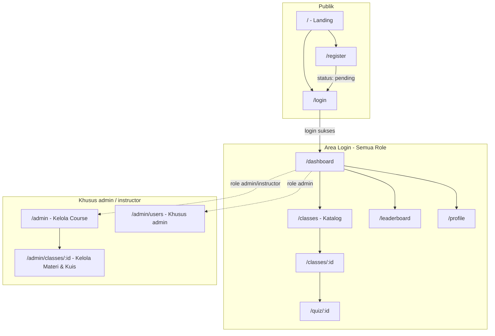
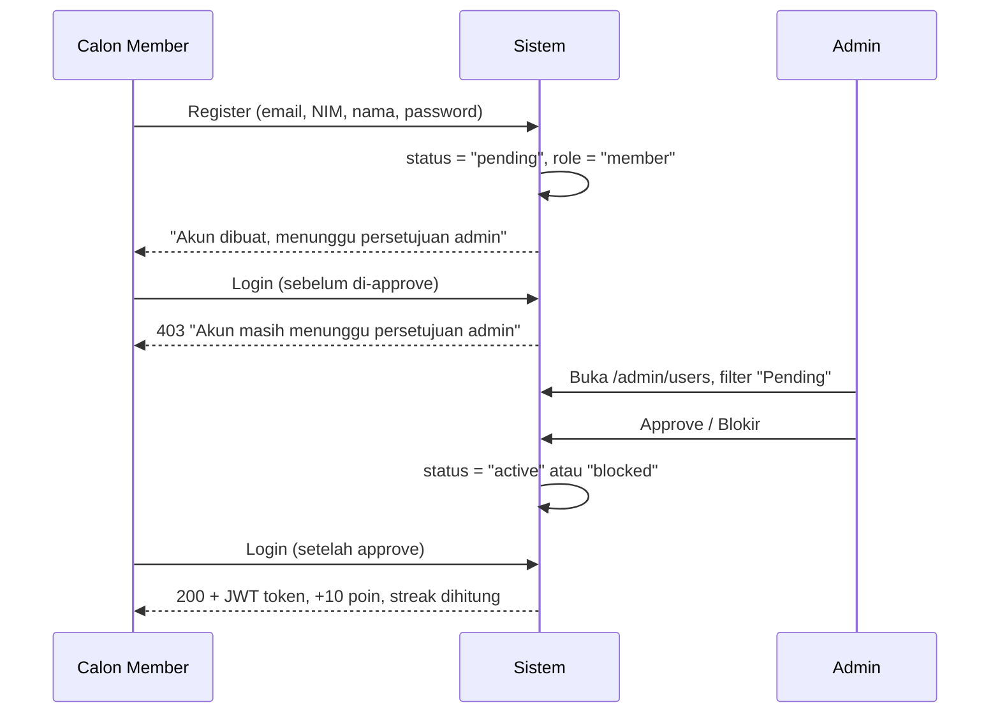

# Product Requirements Document (PRD): LMS English Club Vokasi UB

> **Revisi:** 2026-07-26 — dokumen ini merevisi total versi sebelumnya (13 Juli 2026). Versi lama berhenti mendokumentasikan di "Fase 4", padahal Fase 5 (Kuis) dan modul Moderasi User sudah berjalan di kode tanpa tercatat. Revisi ini menambahkan peta situs, alur pengguna, status per-fitur yang akurat terhadap kode saat ini, dan backlog konsistensi UI/UX.

## 1. Ringkasan Produk

**Apa:** Learning Management System berbasis web untuk anggota English Club, Vokasi Universitas Brawijaya (UB) — tempat mahasiswa mendaftar kelas bahasa Inggris, mengakses materi, mengerjakan kuis, dan bersaing di leaderboard poin keaktifan.

**Masalah yang diselesaikan:** Sebelumnya distribusi materi & pendaftaran kelas English Club dilakukan manual (grup chat/spreadsheet), sulit dipantau instructor dan tidak ada insentif keaktifan bagi member.

**Tujuan produk (goals):**
1. Satu pintu masuk terpusat untuk katalog kelas, materi, dan kuis.
2. Instructor bisa mandiri mengelola kelas & materi tanpa bantuan admin/dev.
3. Admin bisa memoderasi siapa yang boleh masuk sistem (approval akun).
4. Gamifikasi (poin, streak, leaderboard) mendorong keaktifan member.

**Bukan tujuan (non-goals) saat ini:**
- Bukan platform video-conferencing/live class — hanya distribusi materi berupa tautan (dokumen/video/PDF eksternal).
- Bukan sistem pembayaran/berbayar.
- Belum menyasar skala multi-organisasi (single-tenant, khusus English Club Vokasi UB).

## 2. Aktor & Persona

| Role | Deskripsi | Tujuan utama | Titik frustrasi jika gagal |
|---|---|---|---|
| **Member** | Mahasiswa anggota klub | Ikut kelas, akses materi, naik peringkat leaderboard | Tidak tahu status akun (pending/blocked) tanpa penjelasan jelas |
| **Instructor** | Mentor/dosen pengelola kelas | Kelola materi & kuis kelasnya, pantau peserta | Tidak bisa lihat siapa yang harus di-follow up |
| **Admin** | Pengelola sistem | Moderasi akun baru, kelola seluruh kelas & user | Antrian approval menumpuk tanpa notifikasi |

Role ditentukan oleh field `role` (`member` default saat register; `instructor`/`admin` di-set manual di database — belum ada UI untuk promote role).

## 3. Peta Situs (Site Map)

SPA React (`react-router-dom`), route bersih tanpa `.html`:

**Status gap (§11 versi sebelumnya, sudah diselesaikan lewat migrasi Fase 6):**
- ~~`index.html` menampilkan kartu kelas hardcoded/dummy~~ — landing page (`LandingPage.tsx`) sekarang murni marketing ("Cara Kerja" 3 langkah), tidak ada lagi data course palsu.
- Halaman "pending approval" khusus belum ada; pesan status masih muncul sebagai toast error di `/login` saat login gagal (tetap tercatat sebagai gap, lihat §11).

## 4. Alur Pengguna Utama (Core User Flows)

### 4.1 Registrasi & Approval Akun (belum pernah didokumentasikan sebelumnya)

Status akun: `pending` (default) → `active` (bisa login & pakai sistem) atau `blocked` (login ditolak permanen sampai admin aktifkan lagi).

### 4.2 Member: Enroll Kelas → Materi → Kuis
1. Login → `/dashboard` (ringkasan poin, streak, kelas diikuti).
2. `/classes` → lihat katalog semua kelas (real data, `GET /api/v1/classes`).
3. Klik kelas → `/classes/:id` → tombol **Enroll** (+50 poin, sekali per kelas, dicegah duplikasi).
4. Setelah enroll → lihat daftar materi (link/video/PDF) dan daftar kuis kelas tsb.
5. Klik kuis → `/quiz/:id` → jawab → submit → skor dihitung otomatis, +20 poin per percobaan (tidak dibatasi jumlah attempt saat ini — lihat §11).

### 4.3 Instructor: Kelola Kelas
1. Login sebagai instructor → sidebar menampilkan menu **Admin: Kelola Course**.
2. `/admin` → hanya menampilkan kelas yang **dia ampu** (`getManagedClasses` filter by `instructorId`), buat kelas baru.
3. `/admin/classes/:id` → tambah/edit/hapus materi, buat/hapus kuis (belum ada edit kuis — lihat §11), lihat daftar peserta terdaftar (NIM & nama).
4. Instructor **tidak bisa** mengakses/mengedit kelas milik instructor lain (403 Forbidden ditegakkan di controller).

### 4.4 Admin: Moderasi & Kontrol Penuh
1. Admin melihat **semua** kelas (tanpa filter instructor) di `/admin`.
2. `/admin/users` → filter user by status (All/Pending/Active/Blocked) via MUI `DataGrid` → approve/blokir/aktifkan kembali.
3. Admin punya hak yang sama seperti instructor di semua kelas (bypass cek kepemilikan).

## 5. Functional Requirements per Modul

Status: `[Selesai]` sudah selesai & terpakai di produksi · `[Gap]` selesai tapi punya catatan/kekurangan (lihat detail di baris terkait) · `[Rencana]` direncanakan, belum dikerjakan.

### 5.1 Autentikasi & Manajemen Akun
- [Selesai] Registrasi dengan validasi server-side (Joi): email unik, NIM unik & numerik, password min. 6 karakter.
- [Selesai] Login dengan JWT (expiry 30 hari), password di-hash bcrypt.
- [Selesai] Approval akun oleh admin (pending/active/blocked) — §4.1.
- [Selesai] Endpoint `GET/PUT /api/v1/auth/me` untuk profil sendiri.
- [Gap] Tidak ada lupa password / reset password.
- [Gap] Tidak ada verifikasi email.
- [Rencana] UI untuk admin mengubah role user (saat ini hanya lewat database langsung).

### 5.2 Manajemen Kelas & Materi
- [Selesai] CRUD kelas (create/update/delete) oleh admin & instructor, dibatasi kepemilikan untuk instructor.
- [Selesai] CRUD materi per kelas (title, url, type: link/video/pdf), validasi URL wajib `http(s)://`.
- [Selesai] Enrollment member ke kelas, dicegah duplikasi, +50 poin.
- [Selesai] Daftar peserta per kelas untuk instructor/admin (NIM, nama, tanggal join).
- [Rencana] Kapasitas/limit kuota peserta per kelas.
- [Rencana] Kategori/tag kelas untuk filter di katalog (saat ini flat list).

### 5.3 Kuis & Penilaian Otomatis (Fase 5 — sebelumnya tidak tercatat di PRD lama)
- [Selesai] Instructor/admin membuat kuis (judul + minimal 1 soal, tiap soal 2–6 opsi).
- [Selesai] Member mengerjakan kuis dari kelas yang sudah di-enroll (member non-enroll ditolak 403).
- [Selesai] Penilaian otomatis saat submit, skor dalam persen, +20 poin per attempt.
- [Selesai] Hapus kuis oleh pemilik kelas/admin.
- [Gap] Tidak ada edit kuis/soal setelah dibuat (hanya create & delete).
- [Gap] Tidak ada pembatasan jumlah attempt — member bisa submit berkali-kali dan poin bertambah tiap kali (potensi eksploitasi poin, lihat §11).
- [Rencana] Instructor melihat rekap skor seluruh peserta per kuis (saat ini hanya attempt milik diri sendiri yang di-query).

### 5.4 Gamifikasi (Poin, Streak, Leaderboard)
- [Selesai] Poin dari: enroll kelas (+50), submit kuis (+20/attempt), login harian (+10 jika hari baru).
- [Selesai] Streak harian dihitung berdasarkan `last_active_at` (reset ke 1 jika lompat >1 hari).
- [Selesai] Leaderboard publik top-10 (hanya user berstatus `active`).
- [Rencana] Rincian riwayat perolehan poin (saat ini hanya total angka, tidak ada log transaksi poin).

### 5.5 Administrasi & Moderasi Pengguna
- [Selesai] Admin melihat semua user + filter status (all/pending/active/blocked).
- [Selesai] Approve (→active) & block (→active atau blocked) dengan konfirmasi modal.
- [Rencana] Notifikasi (in-app/email) ke member saat akunnya di-approve — saat ini member harus coba login manual untuk tahu statusnya berubah.
- [Rencana] Pagination/search di tabel user (saat ini load semua user sekaligus — akan jadi masalah begitu jumlah member besar).

### 5.6 Profil Pengguna
- [Selesai] Edit bio, telepon, program studi, avatar (via URL).
- [Selesai] Lihat total poin & streak di halaman profil.
- [Rencana] Upload avatar langsung (saat ini hanya menerima URL gambar eksternal).

## 6. Non-Functional Requirements

- **Validasi input:** Wajib pakai middleware `validate()` + skema Joi (`src/middlewares/validate.js`) untuk **semua** endpoint yang menerima body — jangan validasi manual ad-hoc di controller.
- **Error handling:** Semua controller wajib dibungkus `asyncHandler`, error mengalir ke `errorHandler` terpusat. Format response konsisten: `{ success, data?, message?, error?: { message } }`. Jangan buat format response baru di luar pola ini.
- **Keamanan:**
  - [Selesai] Password di-hash bcrypt, JWT untuk sesi, RBAC middleware (`authorize(...roles)`).
  - [Rencana] Rate limiting untuk endpoint login/register (belum ada — rawan brute force).
  - [Rencana] CSRF/XSS hardening tambahan untuk konten materi berupa URL bebas dari instructor.
- **Skalabilitas:** SQLite cukup untuk skala klub (ratusan user). Migrasi ke Postgres perlu dipertimbangkan jika jumlah user/kelas tumbuh signifikan atau butuh akses concurrent tinggi.

## 7. UI/UX Requirements

**Source of truth visual:** [`design.md`](./design.md) — token warna, tipografi, spacing, komponen. Dokumen ini (`requirement.md`) mengatur *behavior* & *flow*, bukan visual detail.

**Aturan wajib (berlaku untuk `src/client/`, ditegakkan sejak migrasi Fase 6 selesai):**
1. **Dilarang inline `sx={{ fontSize: ... }}`/hardcoded hex color** untuk properti yang sudah ada di theme (`src/client/theme.ts`). Styling wajib lewat `theme` (palette/typography/shape) atau `sx` yang mereferensikan token theme (`'primary.main'`, dst) — bukan nilai mentah.
2. Setiap halaman dengan data async wajib punya 3 state eksplisit: **loading** (`<PageLoader />`/MUI `Skeleton`), **empty** (`<EmptyState />` dengan ikon `@mui/icons-material`), dan **error** (toast via `useToast()`) — jangan biarkan state kosong tanpa feedback. Pola ini sudah konsisten dipakai di semua halaman (`DashboardPage`, `ClassesPage`, `AdminUsersPage`, dst).
3. Semua notifikasi aksi (create/update/delete/approve/reject) wajib pakai `useToast().showToast()`, semua konfirmasi destruktif wajib pakai `useConfirm()` — jangan pakai `alert()`/`confirm()` browser bawaan.
4. Landing page (`LandingPage.tsx`) **tidak boleh menampilkan data kelas palsu** — sudah diterapkan: halaman kini murni marketing ("Cara Kerja" 3 langkah), tanpa data course spesifik.
5. `AppShell.tsx` (`Drawer` + `AppBar`) adalah satu-satunya sumber navigasi — dilarang hardcode menu navigasi baru di komponen halaman lain.
6. Ikon wajib dari `@mui/icons-material`, bukan emoji atau SVG custom baru (lihat `design.md` §8.7).

## 8. Model Data (Ringkas)

Entitas utama (Prisma): `User` (role, status, points, streak_days), `Class` (instructorId), `Material` (classId, type), `Enrollment` (userId+classId unik), `Quiz` (classId), `Question` (quizId, options JSON, correct_answer), `QuizAttempt` (quizId, userId, score).

## 9. Tech Stack

- **Frontend:** React + TypeScript + MUI (Material UI), ikon dari `@mui/icons-material` (bukan emoji — lihat `design.md` §8.7), SPA di-build via Vite (`src/client/`, output `dist/client/`), routing via `react-router-dom`. Migrasi dari Vanilla JS/HTML lama selesai 2026-07-26 mengikuti rencana di `design.md` §8; `public/*.html` & `public/js/*.js` lama sudah dihapus.
- **Backend:** Node.js (ES Modules), Express 5. *(Tidak berubah oleh migrasi frontend — Express tetap serve API & static assets hasil build.)*
- **Database:** SQLite + Prisma Client v5.
- **Validasi:** Joi.
- **Auth:** JWT (`jsonwebtoken`) + bcrypt.
- **Dev tooling:** nodemon (`npm run dev`, backend `localhost:3000`) + Vite (`npm run dev:client`, dev server dengan proxy `/api`); `npm run build:client` untuk build produksi, `npm run typecheck` untuk `tsc --noEmit`. Lihat `design.md` §8.3.
- [Rencana] **Belum ada:** automated test suite (`npm test` saat ini masih placeholder `exit 1`).

## 10. Roadmap / Fase Pengembangan

| Fase | Cakupan | Status |
|---|---|---|
| 1 | Autentikasi & manajemen pengguna dasar | Selesai |
| 2 | Manajemen modul kelas (katalog, enroll, materi) | Selesai |
| 3 | Antarmuka instructor & admin, RBAC | Selesai |
| 4 | Gamifikasi (poin, streak, leaderboard, profil) | Selesai |
| 5 | Kuis interaktif & penilaian otomatis | Selesai *(belum tercatat di versi PRD sebelumnya)* |
| 5.5 | Moderasi user (pending/approve/block) | Selesai *(belum tercatat di versi PRD sebelumnya)* |
| **6.1** | Migrasi UI Batch 1: Fondasi & Auth (tema MUI, shell, `index`/`login`/`register`) | Selesai (2026-07-26) |
| **6.2** | Migrasi UI Batch 2: Member Core (`dashboard`, `classes`, `class-detail`, `quiz`) | Selesai (2026-07-26) |
| **6.3** | Migrasi UI Batch 3: Gamifikasi & Profil (`leaderboard`, `profile`) | Selesai (2026-07-26) |
| **6.4** | Migrasi UI Batch 4: Admin (`admin-dashboard`, `admin-class`, `admin-users` + `DataGrid`) | Selesai (2026-07-26) — `public/*.html` & `public/js/*.js` lama sudah dihapus |

## 11. Known Issues / Debt Backlog (temuan konkret dari audit kode saat ini)

Prioritas disusun dari yang paling berdampak ke pengguna:

1. ~~Landing page menampilkan data kelas dummy/hardcoded~~ — **Selesai.** `LandingPage.tsx` (Fase 6.1) sudah murni marketing, tanpa data course palsu.
2. ~~Poin kuis bisa di-exploit~~ — **Selesai (2026-07-26).** `submitQuiz` di `quizController.js` sekarang hanya memberi +20 poin pada attempt **pertama** per quiz per user (dicek via `prisma.quizAttempt.count`); attempt ulang tetap dinilai & tersimpan tapi tidak menambah poin lagi.
3. **Tidak ada notifikasi saat akun di-approve** — member harus coba-coba login untuk tahu statusnya sudah aktif. **Sengaja belum dikerjakan** — perbaikan nyata (email/push) butuh keputusan infra (SMTP provider & kredensial) yang harus datang dari pemilik produk, bukan diasumsikan.
4. ~~Inline style menyimpang dari `design.md`~~ — **Selesai.** Diganti theming terpusat MUI (`src/client/theme.ts`) di Fase 6.1; halaman lama yang mengandung inline style sudah dihapus.
5. ~~Tidak ada pagination di tabel user~~ — **Selesai.** `AdminUsersPage` (Fase 6.4) memakai MUI `DataGrid` dengan pagination & sorting bawaan.
6. **Tidak ada automated test** — `npm test` masih placeholder. **Sengaja belum dikerjakan** (keputusan eksplisit 2026-07-26) — belum prioritas saat ini, revisit kalau kebutuhan regression-safety meningkat.
7. ~~Housekeeping repo: file `NUL` nyasar~~ — **Selesai.** File `NUL` (artefak redirect Windows) dan `dev.db` duplikat di root (database aktif ada di `prisma/dev.db`, ditentukan oleh `DATABASE_URL` di `.env`) sudah dihapus — keduanya tidak pernah ter-track git (`*.db` sudah di `.gitignore`). Working tree masih punya perubahan besar belum di-commit — commit dalam potongan logis menunggu instruksi eksplisit (lihat kebijakan commit di §12).

## 12. Deployment & Version Control

- **Version Control:** Git & GitHub (`https://github.com/znlumins/learning-management-system-for-lso-vokasi-ub.git`).
- **Server Dev:** `nodemon` di `localhost:3000`.
- **Environment:** `.env.example` tersedia sebagai template — pastikan `JWT_SECRET` diganti dari nilai default sebelum deploy (ada warning otomatis di `app.js` jika lupa).
